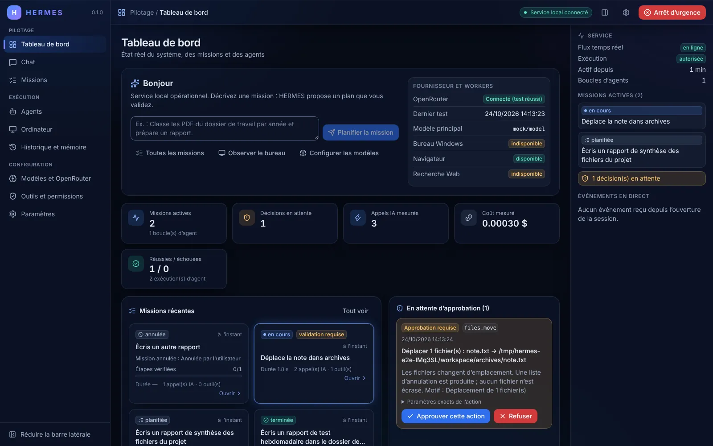
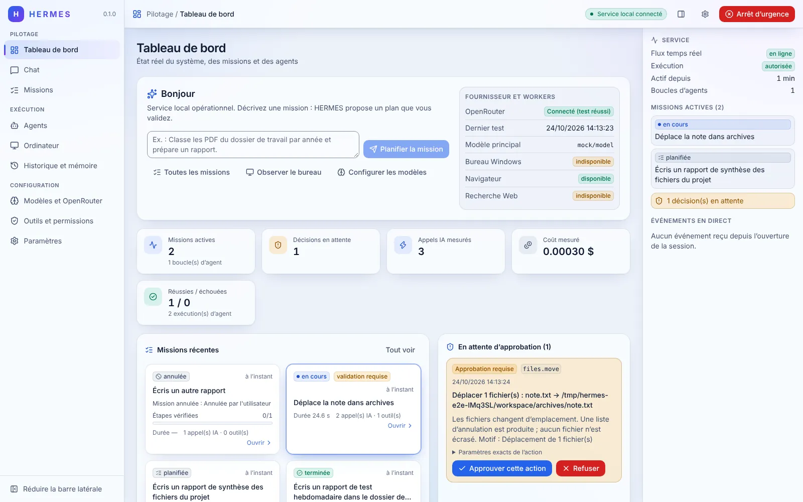
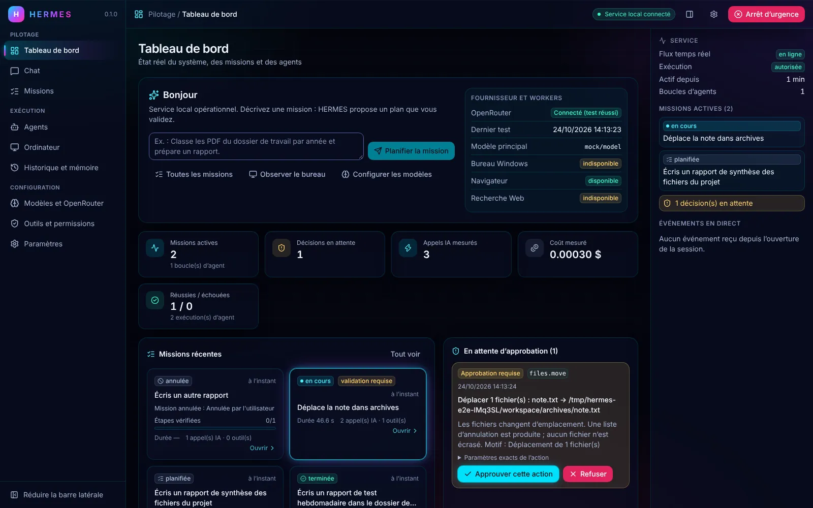
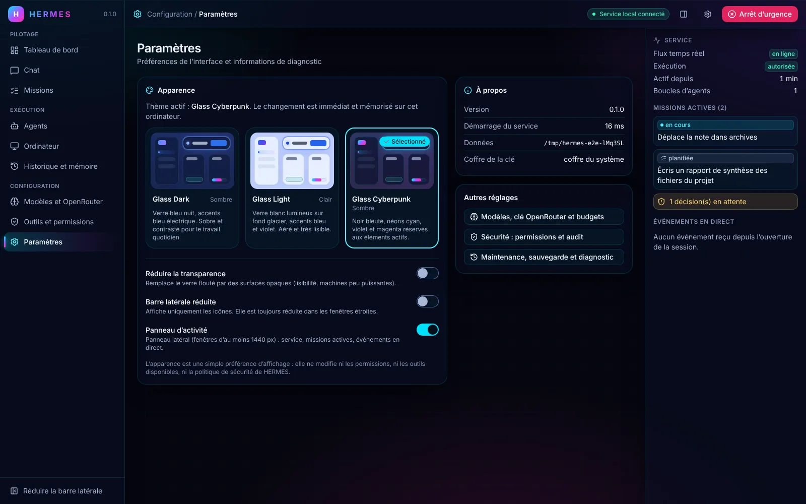
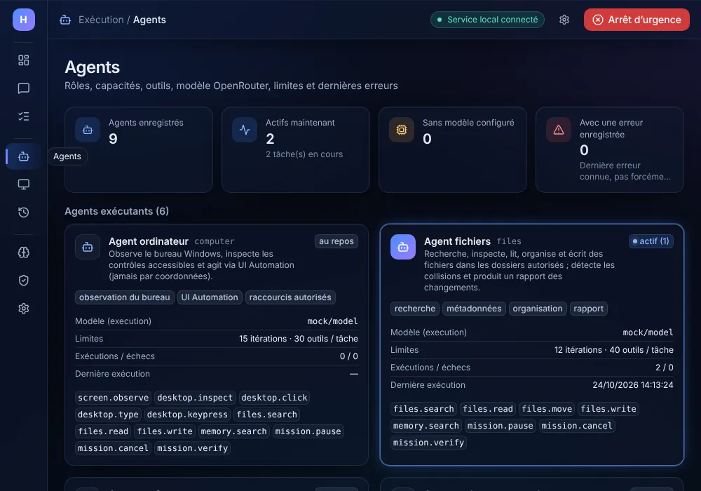

# Refonte UI « Glass » — audit et suivi d'implémentation

Ce document suit la refonte visuelle de l'interface desktop (`apps/desktop`) en trois thèmes : **Glass Dark**, **Glass Light** et **Glass Cyberpunk**. Il décrit l'état initial, le plan, les choix réalisés et ce qui reste à faire. Il est mis à jour à chaque lot.

## 1. État initial (audit du 24/10/2026)

### Architecture réelle

| Élément             | Constat                                                                                                                                                                                                                     |
| ------------------- | --------------------------------------------------------------------------------------------------------------------------------------------------------------------------------------------------------------------------- |
| Point d'entrée      | `apps/desktop/src/main.tsx` → `App.tsx` (shell + navigation) ; `index.html` force `class="dark"`                                                                                                                            |
| Navigation          | Pas de routeur : `useApp().page` (Zustand, `store.ts`) choisit un composant dans `PAGES` ; `navigate(page, missionId?)`                                                                                                     |
| Pages (8)           | `dashboard`, `chat`, `missions`, `computer`, `agents`, `models`, `tools`, `history` (`src/pages/*.tsx`)                                                                                                                     |
| Données             | `api.ts` (fetch + Bearer fourni par Tauri ou injecté par le proxy Vite) ; `hooks.ts` : `useResource` recharge sur chaque événement persistant (SSE `/api/stream`, compteur `revision`) ; `useAction` pour les mutations     |
| Temps réel          | `store.ts` : `subscribe()` SSE ; `events` (500 derniers événements reçus en direct), `streams` (sortie du modèle par mission), `connected`                                                                                  |
| Missions            | Création `POST /api/missions` (Chat) → plan validé → `start/pause/cancel` (`MissionView`) ; approbations `POST /api/approvals/:id` (`ApprovalCard`)                                                                         |
| Agents              | `GET /api/agents` : registre réel du runtime (`activeTasks`, `stats.lastError`, `lastRunAt`)                                                                                                                                |
| Fournisseur LLM     | OpenRouter uniquement, clé dans le coffre OS côté service ; l'UI ne reçoit que `hasKey`/`source`                                                                                                                            |
| Styles              | Tailwind v4 (`@tailwindcss/vite`), un seul `styles.css` (accent oklch) ; couleurs `slate-*` + variantes `dark:` codées en dur dans chaque composant (≈ 150 occurrences)                                                     |
| Thème               | `theme: 'dark' \| 'light'` dans `useApp`, persisté dans `localStorage['hermes.theme']`, bouton bascule dans la barre latérale ; flash possible au démarrage (classe `dark` codée en dur dans le HTML)                       |
| Composants partagés | `components/ui.tsx` (Button, Card, Badge, StatusBadge, ErrorBox, Empty, Loading, Input/Textarea/Select, Field, PageHeader, Json, formats) ; `components/shared.tsx` (ApprovalCard, EventList, PlanView) ; `MissionView.tsx` |
| Icônes              | `lucide-react` déjà présent                                                                                                                                                                                                 |
| Sécurité UI         | CSP Tauri `script-src 'self'` (aucun script inline possible), `style-src 'unsafe-inline'`                                                                                                                                   |

### Scripts disponibles (racine)

`format:check`, `lint`, `typecheck` (racine + desktop), `test` (Vitest unit/intégration/sécurité, environnement `node`, pas de jsdom), `test:e2e` (Playwright contre le vrai service + OpenRouter simulé + Vite), `build` (`pnpm -r run build`), `bench`, `tauri`. Rust : `cargo test` dans `apps/desktop/src-tauri`.

### Vérifications de référence (avant toute modification)

| Commande                              | Résultat                                                                                                                                                                   |
| ------------------------------------- | -------------------------------------------------------------------------------------------------------------------------------------------------------------------------- |
| `pnpm format:check`                   | ❌ préexistant : `ROADMAP.md` non formaté                                                                                                                                  |
| `pnpm lint`                           | ✅                                                                                                                                                                         |
| `pnpm typecheck`                      | ✅                                                                                                                                                                         |
| `pnpm --filter @hermes/desktop build` | ✅ (CSS 24,9 kB, JS 297 kB)                                                                                                                                                |
| `pnpm test`                           | 102 ✅ / 4 ❌ / 5 ignorés — les 4 échecs sont environnementaux (Chromium Playwright 1.64.1 absent du conteneur Linux) ; les tests UI Automation sont ignorés hors Windows  |
| `pnpm test:e2e`                       | ✅ 6/6 après avoir fait pointer, **dans le conteneur uniquement**, la révision Chromium attendue (1248) vers la révision installée (1243) — aucun changement dans le dépôt |

### Problèmes identifiés

1. Couleurs dispersées : chaque composant porte ses propres `slate-*`/`dark:` ; impossible d'ajouter un troisième thème sans dupliquer chaque classe.
2. Pas de page Paramètres : le thème est un simple bouton bascule.
3. Flash de thème au démarrage (classe `dark` statique, thème appliqué après le montage React).
4. Statuts signalés uniquement par la couleur du badge (pas d'icône).
5. Barre latérale fixe de 240 px, non réductible ; pas de comportement pour fenêtre étroite.
6. Pas de vue d'ensemble des agents ni de création rapide de mission sur le tableau de bord.
7. `CONNECTION_LABEL` défini dans une page (`Dashboard.tsx`) et importé par une autre (`Models.tsx`).
8. Les mêmes listes « mission » (badge + intitulé + date) sont réécrites dans Dashboard, Chat, Missions et Historique.

### Incompatibilités entre la maquette demandée et l'architecture réelle

- **Pages absentes** : Fichiers, Navigateur, Code, Mémoire, Planification et Sécurité n'existent pas comme routes. Conformément aux règles, aucune route fictive n'est créée : la mémoire est dans « Historique et mémoire », la sécurité et les permissions dans « Outils et permissions », le navigateur et le bureau dans « Ordinateur » (bureau) et le catalogue d'outils. Seule la page **Paramètres** est ajoutée, car elle porte une fonction réelle (sélecteur d'apparence et informations de diagnostic autorisées).
- **Progression des missions** : la liste `/api/missions` ne contient pas l'état des tâches ; une barre de progression n'est affichée que là où elle est calculable (détail d'une mission avec ses tâches, ou résultat consolidé).
- **État « validation requise »** : ce n'est pas un statut de mission ; il est dérivé des approbations réellement en attente (`/api/approvals?status=pending`, champ `missionId`).
- **Dernière activité / tâche courante d'un agent** : seuls `activeTasks`, `stats.lastRunAt` et `stats.lastError` existent ; aucune « tâche en cours » détaillée n'est inventée.
- **Libellés de navigation** conservés (« Modèles et OpenRouter », « Outils et permissions »…) : ils sont exacts et utilisés par les tests E2E.

## 2. Plan de refonte

| Lot | Contenu                                                                                                                                                                                        |
| --- | ---------------------------------------------------------------------------------------------------------------------------------------------------------------------------------------------- |
| A   | Audit (ce document), tokens CSS, 3 thèmes, module de thème typé et testable, persistance + migration de l'ancienne valeur, script anti-flash, sélecteur Paramètres → Apparence                 |
| B   | `AppShell` : barre latérale réductible (sections, infobulles, mode compact automatique), barre supérieure (titre, état réel du service, arrêt d'urgence, accès Paramètres), panneau d'activité |
| C   | Tableau de bord : accueil + mission rapide, indicateurs réels, missions récentes (`MissionCard`), agents (`AgentCard`), approbations, activité (`ActivityList`)                                |
| D   | Migration de toutes les pages et composants vers les tokens (aucune classe `slate-*`/`dark:` restante)                                                                                         |
| E   | Micro-interactions CSS, `prefers-reduced-motion`, `prefers-reduced-transparency`, option « réduire la transparence », tests unitaires et E2E, captures des 3 thèmes                            |

### Fichiers créés et modifiés

- **Créés** : `src/theme.ts` (types, validation, migration, persistance), `src/prefs.ts` (store Zustand des préférences d'interface), `src/labels.ts` (libellés et tonalités partagés), `public/theme-boot.js` (anti-flash), `src/components/layout/{AppShell,Sidebar,Topbar,ActivityPanel,nav}.tsx|ts`, `src/components/theme/ThemeSelector.tsx` (`ThemeSelector` + `ThemePreview`), `src/components/cards.tsx` (`MissionCard`, `MissionListItem`, `AgentCard`), `src/pages/Settings.tsx`, `tests/unit/theme.test.ts`, `tests/e2e/theme.spec.ts`, `docs/ui-glass/*.webp`.
- **Réécrits** : `src/styles.css` (design system), `src/App.tsx` (délègue au shell), `src/components/ui.tsx` (mêmes exports + `ProgressBar`, `Stat`, `DataList`, `Switch`, `Code`, `fmtRelative`), `src/pages/Dashboard.tsx`, `src/pages/Agents.tsx`.
- **Adaptés** : `index.html`, `src/store.ts` (route `settings`, thème déplacé dans `prefs.ts`), `src/hooks.ts` (`useMediaQuery`), `src/components/shared.tsx`, `src/components/MissionView.tsx`, `src/pages/{Chat,Missions,Computer,History,Models,Tools}.tsx`.
- **Non modifiés** : `src/api.ts`, le service (`apps/server`), `@hermes/core` (contrats, orchestrateur, politique, coffre), le shell Rust/Tauri et sa CSP.

## 3. Ce qui a été réalisé

### Design system (lot A)

- Toutes les couleurs, surfaces, bordures, ombres, halos, flous et dégradés sont des variables `--hm-*` redéfinies par thème sur `[data-theme]`. Tailwind v4 les expose via `@theme inline` sous forme d'utilitaires sémantiques : `bg-bg`, `bg-surface`, `bg-raised`, `bg-solid`, `text-fg`, `text-muted`, `text-faint`, `border-line`, `border-line-strong`, `bg-accent`, `text-accent-fg`, `text-on-accent`, `bg-{success,warning,danger,info,neutral}-soft`, `text-{…}-fg`, `bg-danger-fill`, `rounded-{panel,card,control}`.
- Jetons communs : rayons (18/14/10 px), unité d'espacement, largeur de barre latérale (déployée/réduite), hauteur de barre supérieure et d'entrée de navigation, durées (140/220 ms) et courbe des transitions, intensité du flou, focus clavier.
- **Plus aucune** classe `slate-*`, `red-*`, `amber-*`… ni variante `dark:` dans les composants : les trois thèmes ne diffèrent que par leurs jetons, plus quatre règles réservées au Cyberpunk (indicateur de navigation, barre de progression, bouton principal néon).
- Classes de composants : `.glass` (verre : fond translucide + `backdrop-filter`), `.app-backdrop` (dégradés statiques peints une fois), `.nav-item`, `.card-hover`, `.is-live` (halo réservé à ce qui s'exécute réellement), `.live-dot`, `.progress-track/.progress-bar`, `.appear`, `.press`, `.theme-preview`.

### Thèmes

| Thème           | Fond / surfaces                                                         | Accents                              | Particularités                                                                     |
| --------------- | ----------------------------------------------------------------------- | ------------------------------------ | ---------------------------------------------------------------------------------- |
| Glass Dark      | bleu nuit `#070b16`, verre bleu foncé à 64 %                            | bleu électrique, violet              | défaut (comportement antérieur : sombre)                                           |
| Glass Light     | bleu glacier `#edf2fa`, verre blanc à 66 %                              | bleu `#2563eb`, violet `#7c3aed`     | ombres diffuses, bordures de contrôle à 3:1, couleurs d'état assombries pour l'AA  |
| Glass Cyberpunk | noir bleuté `#05060f`, trame cyan très discrète, verre bleu nuit à 66 % | cyan `#00e1fb`, violet néon, magenta | texte sombre sur le cyan, néons limités aux éléments actifs et au bouton principal |

Contrastes calculés (texte principal, secondaire, tertiaire, accent et 5 états, sur surface et surface surélevée, translucidité composée sur le fond) : minimum **4,55:1** (Dark), **4,84:1** (Light), **4,58:1** (Cyberpunk) ; bordures de champs ≥ 3:1 dans les trois thèmes.

Captures réelles (service local + modèle simulé) :

| Glass Dark                                                        | Glass Light                                                         | Glass Cyberpunk                                                             |
| ----------------------------------------------------------------- | ------------------------------------------------------------------- | --------------------------------------------------------------------------- |
|  |  |  |

 

### Sélection et persistance

- `AppTheme = 'glass-dark' | 'glass-light' | 'glass-cyberpunk'`, appliqué via `<html data-theme>` et `color-scheme`.
- Persistance dans `localStorage['hermes.theme']` (même clé que l'ancien interrupteur). Migration : `light` → Glass Light, `dark` → Glass Dark ; toute autre valeur ou un stockage indisponible → Glass Dark.
- **Anti-flash** : `public/theme-boot.js` (fichier externe, la CSP `script-src 'self'` interdisant le script inline) applique le thème et l'option de transparence avant le premier rendu. Un test unitaire exécute ce script dans une VM et vérifie qu'il interprète chaque valeur exactement comme `parseTheme`.
- Changement instantané sans rechargement ; fondu des couleurs limité à ~300 ms pendant la bascule (classe `theme-switching`), pour que les survols restent instantanés le reste du temps.
- **Paramètres → Apparence** : groupe de boutons radio natifs (flèches, Tab, lecteurs d'écran), aperçu de chaque thème dessiné avec ses propres jetons, nom, description, état « Sélectionné » visible. Options supplémentaires : réduire la transparence, barre latérale réduite, panneau d'activité.
- Le thème est une préférence d'affichage : aucun lien avec les permissions, les outils ou la politique (rappel affiché dans la page).

### Layout (lot B)

- **Barre latérale** : sections Pilotage / Exécution / Configuration avec les 9 routes réelles, icônes Lucide, entrée active (fond dégradé + indicateur), navigation aux flèches, Début/Fin ; réductible (préférence mémorisée) et **toujours compacte sous 1100 px**, avec infobulles au survol et au focus clavier ; les libellés restent les noms accessibles.
- **Barre supérieure** : section / page courante, état réel de la connexion SSE au service, bascule du panneau d'activité, accès aux paramètres, arrêt d'urgence / réarmement (inchangés). Bandeau d'alerte pleine largeur pendant l'arrêt d'urgence.
- **Contenu** : lien d'évitement « Aller au contenu », largeur maximale, défilement vertical seul, retour en haut à chaque changement de page.
- **Panneau d'activité** (≥ 1440 px, masquable) : état du flux temps réel, exécution autorisée/bloquée, durée de fonctionnement, boucles d'agents, missions actives cliquables, décisions en attente, événements reçus en direct. Il n'émet **aucune requête** : il réutilise `/api/status` déjà interrogé par le shell et les événements SSE du store.

### Tableau de bord (lot C)

- Accueil : salutation, phrase d'état dérivée de la connexion réelle et de l'arrêt d'urgence, **création rapide de mission** (même appel que la page Chat, puis ouverture de la mission dans Chat), raccourcis vers Missions, Ordinateur et Modèles, avertissement si clé ou modèle manquant.
- Encadré fournisseur et workers : état OpenRouter **mesuré** par le dernier test (jamais supposé), modèle principal, disponibilité réelle des workers.
- Indicateurs : missions actives, décisions en attente, appels IA et coût mesurés, réussites / échecs.
- **Missions récentes** (`MissionCard`) : statut avec icône, « validation requise » uniquement si des approbations sont réellement en attente pour cette mission, demande, résumé ou erreur, progression **uniquement** quand le résultat consolidé liste les étapes vérifiées, durée, appels IA/outils ; halo sur les missions en cours.
- **Agents** (`AgentCard` compact) : nom, rôle, état dérivé du registre (« actif (n) » si `activeTasks > 0`, « modèle non configuré », sinon « au repos »), dernière exécution, dernière erreur connue.
- Approbations en attente (`ApprovalCard` inchangée fonctionnellement), activité récente, informations système.

### Autres écrans (lot D)

Toutes les pages et composants utilisent les jetons et les composants partagés. Ajouts notables : barre de progression des étapes et halo d'exécution dans `MissionView`, liste de missions commune (`MissionListItem`) pour Missions et Chat, état vide illustré, page Agents avec indicateurs et séparation exécutants / planification-vérification, icônes de section, survol des lignes de tableaux, libellés de risque en français.

### Finitions (lot E)

- Statuts jamais signalés par la seule couleur (icône distincte par statut, point animé pour « en cours »).
- `prefers-reduced-motion` coupe toutes les animations et transitions ; `prefers-reduced-transparency`, l'option « Réduire la transparence » et l'absence de prise en charge de `backdrop-filter` remplacent le verre par des surfaces opaques.
- Performance : flou réservé aux panneaux (jamais aux lignes de liste), dégradés de fond statiques, animations limitées aux éléments en cours, transitions sur `transform`/couleurs uniquement, abonnements `matchMedia` nettoyés (`useSyncExternalStore`), aucune nouvelle dépendance. Bundle : CSS 24,9 → 37,2 kB (8,2 kB gzip), JS 297 → 328 kB (98,6 kB gzip).
- Défauts préexistants corrigés en passant : `CONNECTION_LABEL` importé d'une page par une autre (déplacé dans `labels.ts`) ; largeur des champs ignorée (`w-48` toujours écrasé par `w-full` à cause de l'ordre CSS) ; avertissement « OpenRouter non configuré » dupliqué (composant `ProviderWarning`).

## 4. Vérifications (après refonte)

| Commande                                                   | Exécutée | Résultat                                                                                                                                                                                               |
| ---------------------------------------------------------- | -------- | ------------------------------------------------------------------------------------------------------------------------------------------------------------------------------------------------------ |
| `pnpm format:check`                                        | oui      | ❌ uniquement `ROADMAP.md`, déjà non formaté avant la refonte et non modifié ; tous les fichiers touchés sont formatés                                                                                 |
| `pnpm lint`                                                | oui      | ✅                                                                                                                                                                                                     |
| `pnpm typecheck`                                           | oui      | ✅ (racine + desktop)                                                                                                                                                                                  |
| `pnpm build`                                               | oui      | ✅ service + interface ; `dist/theme-boot.js` présent et référencé                                                                                                                                     |
| `pnpm test`                                                | oui      | ✅ 115 réussis, 5 ignorés (UI Automation, Windows uniquement) — dont 9 nouveaux tests de thème. Les 4 échecs de référence venaient du Chromium absent du conteneur et disparaissent avec l'alias local |
| `pnpm test:e2e`                                            | oui      | ✅ 14/14 : les 6 existants inchangés + 8 nouveaux                                                                                                                                                      |
| `cargo test` (`apps/desktop/src-tauri`)                    | tentée   | ⚠️ non compilable dans ce conteneur Linux (bibliothèques système GTK/WebKit absentes) ; aucun fichier Rust ni la CSP n'ont été modifiés. La CI Windows l'exécute                                       |
| Captures (3 thèmes × 3 tailles × 9 pages, données réelles) | oui      | ✅ aucun défilement horizontal, aucune erreur console ; échantillon dans `docs/ui-glass/`                                                                                                              |

Nouveaux tests E2E (`tests/e2e/theme.spec.ts`) : thème par défaut ; sélection des trois thèmes sans rechargement (marqueur `window` conservé) ; restauration après redémarrage, y compris **sans le bundle React** (preuve de l'anti-flash) ; valeur invalide et migration `light` ; clavier (flèches dans le sélecteur, flèches + Entrée dans la navigation, interrupteur au clavier) ; toutes les routes accessibles en barre déployée, réduite et en fenêtre étroite sans défilement horizontal ; cartes du tableau de bord comparées à l'API réelle (statut, agents) ; états de chargement et d'erreur réseau ; arrêt d'urgence puis réarmement.

## 5. Limites et suite

### Non vérifié

- Rendu dans la WebView2 de Windows (tests faits avec Chromium sous Linux, même moteur Blink) et performance du flou sur une machine Windows peu puissante : l'option « Réduire la transparence » est prévue pour ce cas.
- Lecteurs d'écran réels (NVDA, Narrateur) : seuls les rôles, noms et états ARIA sont vérifiés par les tests.
- Tests Rust (voir ci-dessus).

### Feuille de route

| Tâche                                                                            | État                                                                 |
| -------------------------------------------------------------------------------- | -------------------------------------------------------------------- |
| Audit, jetons, 3 thèmes, persistance, migration, anti-flash, sélecteur           | ✅ terminé et testé                                                  |
| Shell : barre latérale réductible, barre supérieure, panneau d'activité          | ✅ terminé et testé                                                  |
| Tableau de bord sur données réelles                                              | ✅ terminé et testé                                                  |
| Migration de toutes les pages vers le design system                              | ✅ terminé (vérifié par captures et E2E)                             |
| Accessibilité : clavier, focus, contrastes AA, mouvement et transparence réduits | ✅ terminé (contrastes calculés, clavier testé)                      |
| Pages Fichiers, Navigateur, Code, Planification dédiées                          | ⏸ non créées volontairement : aucune fonctionnalité réelle derrière  |
| Thème « Système » (suivre clair/sombre de Windows, roadmap § thème adaptatif)    | ⏳ restant                                                           |
| Navigation par URL (historique précédent/suivant) — l'app n'a pas de routeur     | ⏳ restant                                                           |
| Pré-remplissage du panneau d'activité avec les derniers événements persistés     | ⏳ restant (aujourd'hui : uniquement les événements reçus en direct) |
| Tests de régression visuelle automatisés (captures de référence)                 | ⏳ restant                                                           |
